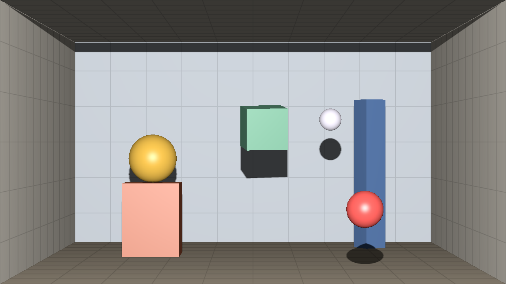
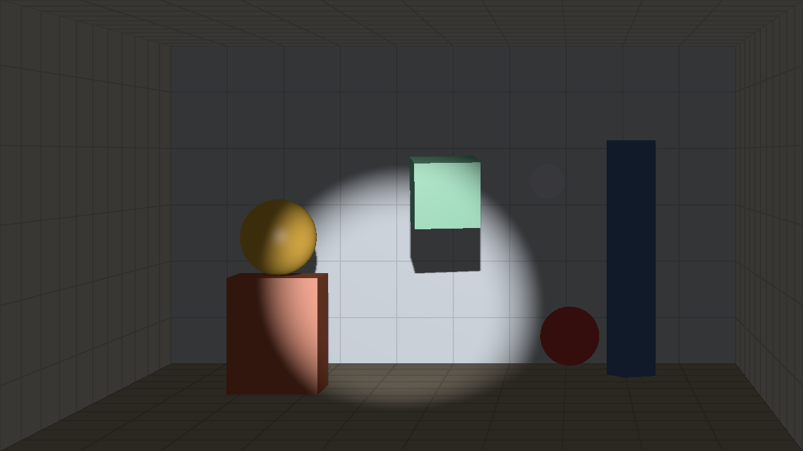

# face-window

A 3D room behind your screen: a webcam tracks your face, the room is re-projected from where your eyes are, and a light at your head throws the objects' shadows onto the walls. The renderer is Rust on [game-toolkit](https://github.com/sunsided/game-toolkit) and wgpu, compiled to WebAssembly; the page around it is a small SvelteKit app that runs MediaPipe's Face Landmarker in a worker.



This is based on Daniel Habib's [True3D Window Mode](https://danielhabib.substack.com/p/a-simpler-way-to-watch-3d), which turns a laptop screen into a window onto a 3D scene with nothing but the webcam, and that is also where I want to take it. The idea itself goes back at least to Johnny Chung Lee's Wii Remote head tracking in 2007. What I added on top so far is the light: with the room lit from where your face is, every lean moves the shadows too.

## Running it

You'll need Rust with the `wasm32-unknown-unknown` target, [`wasm-pack`](https://github.com/rustwasm/wasm-pack), [go-task](https://taskfile.dev) and Node with corepack (yarn 4 is pinned in `web/package.json`). Then:

```sh
task dev     # build the renderer, install and vendor MediaPipe, serve the page with Vite
task run     # native window, the mouse stands in for your head and the wheel for distance
task build   # static site in web/build, no CDN involved, so it works offline
task test    # projection, tracking and scene tests
task lint    # clippy (native and wasm32) and svelte-check
```

In the page, press **Start camera**. `f` toggles fullscreen, `h` hides the panel, `c` centers the view on how you're sitting right now, and `t` logs five seconds of raw tracking data (see "Debugging" below).

## Calibration

The illusion only holds when the page knows real sizes, and a browser won't tell it how large a screen physically is. Without that, the scale is off and the room swings around far too much for every centimeter you move (ask me how I know: a window on a 49" ultrawide that the page believed to be a 15.6" laptop panel makes for a very lively room).

- **Screen size** is kept per screen. The page guesses common panels (a 5120×1440 monitor starts at 49"); **Measure with a card** gets the exact value by resizing an outline until it matches a bank or ID card held against the screen. An orange warning shows up when the entered diagonal implies an implausible pixel density.
- **Camera field of view** sets how distance is estimated. Sit at a distance you measured, enter it, and press **Calibrate**.
- **Center view here** (`c`) takes your current position as straight-on. Physically, eyes above a laptop screen look down onto the floor; recentering trades exactness for a nicer default. It also stores your "straight ahead" gaze for the flashlight.
- **Invert view** mirrors the room's parallax per axis. It is physically wrong, but the mirrored version felt more natural to me; the light always uses your real position either way.
- **Smoothing** and **Prediction** trade jitter against lag (more smoothing and less prediction calms it down, the reverse makes it snappier).

The webcam is assumed to sit centered on the top edge of the screen the window is on. A laptop's built-in camera used with an external monitor breaks that assumption, which shows up as a view that is consistently off to one side.

## Modes

- **View: Window** re-projects the room from your eyes; **Fixed room** keeps the view put and only moves the light with you.
- **Light: Lamp** places the light 8 cm above your eyes (adjustable). A light exactly at the eye hides every shadow behind the object that casts it, so some offset is needed to see any.
- **Light: Flashlight** turns it into a spotlight that points where you look.



Webcam gaze is coarse, a few degrees at best, so expect the beam to wander a little.

## How it works

- **Projection** (`src/projection.rs`): the canvas is a window in the `z = 0` plane, in meters, with `+z` pointing at you. The frustum runs from your eye through the window's edges, which is Kooima's generalized perspective projection, simplified because the window is axis-aligned. Points behind the window move with you relative to its frame, points in front of it against you.
- **Tracking** (`web/src/lib/tracker.worker.ts`, `src/tracking.rs`): the Face Landmarker runs in a module worker fed with `ImageBitmap`s, dropping frames while it's busy rather than queueing them. Each eye's center is the midpoint of its corners, since those stay put when you look around while the irises don't. A pinhole model turns the two centers into a position: depth comes from their pixel distance against an assumed interpupillary distance of 63 mm, the rest follows from the field of view.
- **Filtering** (`src/tracking.rs`): a constant-velocity Kalman filter per axis, using [minikalman](https://github.com/sunsided/minikalman-rs). Besides smoothing, the velocity estimate lets the renderer extrapolate your head to the moment the frame is shown, which hides most of the camera and detection latency. Latency kills the effect faster than imprecision does.
- **Gaze** (`src/tracking.rs`): the iris offset from the eye center, in eye widths, times the ratio of eyeball radius to eye width (about 12 mm over 28 mm) gives the sine of the gaze angle. The flashlight aims at the point where that ray meets the back wall.
- **Rendering** (`src/renderer.rs`, `src/room.wgsl`): a depth-only pass from the light into a 2048² shadow map, whose frustum also goes through the window (widened, so the walls next to the opening get light too), then the lit scene with 3×3 PCF. game-toolkit runs the loop and provides the device; its own 3D path has a fixed light and a symmetric camera, so the room is drawn by a custom pass into the toolkit's frame.

## Browser quirks

- **Chrome on Linux:** with "Unsafe WebGPU Support" enabled in `chrome://flags` and Vulkan disabled, WebGPU runs on Dawn's OpenGL ES compatibility backend on top of ANGLE. wgpu picks WebGPU whenever it's offered, and on that path the page crawled at 16 fps in a small window and 5 fps at 32:9, with face detection on the GPU starving alongside it. Resetting the flag lets wgpu fall back to WebGL2, which runs at the display's refresh rate. Turning Vulkan on instead got WebGPU running at 90 fps, but the canvas stayed black (on X11, at least).
- **Detection on the CPU or the GPU:** both are selectable. On an integrated GPU drawing a large canvas, the CPU delegate keeps detection from competing with the renderer.

## Debugging

In dev mode (`task dev`), the page sends one stats line per second over Vite's websocket to the terminal and to `web/dev-stats.log`: render rate and canvas size, the physical window size it assumes, tracking rate, detection time and delegate, frame age, and the current eye position. `t` adds every single measurement for five seconds. It's far easier to copy from than the browser console, and a lot of the issues above were found by reading it.

## Limitations

- One camera only. A second camera for proper triangulation would make depth a lot more stable, but isn't there yet.
- Depth from eye spacing assumes an average interpupillary distance and a face turned towards the camera; turning your head shrinks the spacing and pushes the estimate back. Iris diameter, which is about 11.7 mm for nearly everyone, would be a more robust measure ([MediaPipe Iris](https://research.google/blog/mediapipe-iris-real-time-iris-tracking-depth-estimation/) describes the method).
- The scene is a fixed set of boxes and spheres.

## Prior art

- Johnny Chung Lee, head tracking for desktop VR displays using the Wii Remote (2007).
- Daniel Habib, [True3D Window Mode](https://github.com/True3DLabs/WindowMode), which estimates distance from the iris size.
- Shopify's [WonkaVision](https://hackaday.com/2023/03/12/immersive-virtual-reality-from-the-humble-webcam) (2023).
- Ian Curtis, [off-axis-sneaker](https://github.com/icurtis1/off-axis-sneaker), and [head-tracked-perspective](https://github.com/Danyals-code/head-tracked-perspective), a cuboid room close to this one.
- Robert Kooima, *Generalized Perspective Projection* (2008), for the math behind the frustum.

## License

Licensed under the [European Union Public Licence 1.2](LICENSE) (EUPL-1.2), like game-toolkit.
